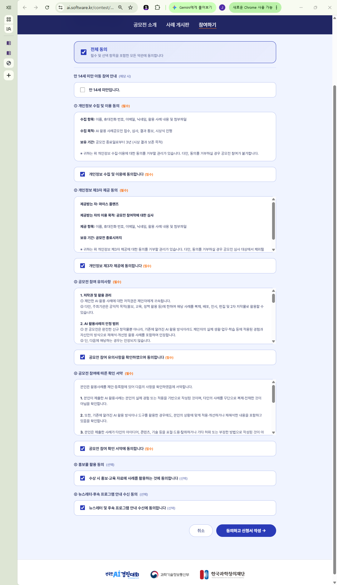
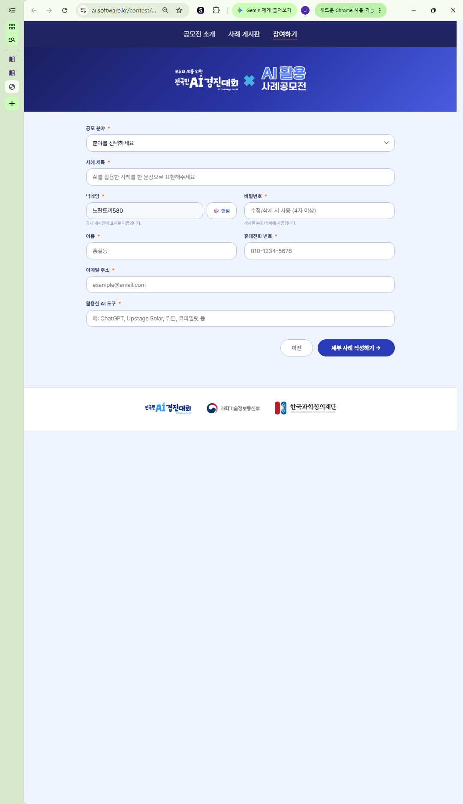
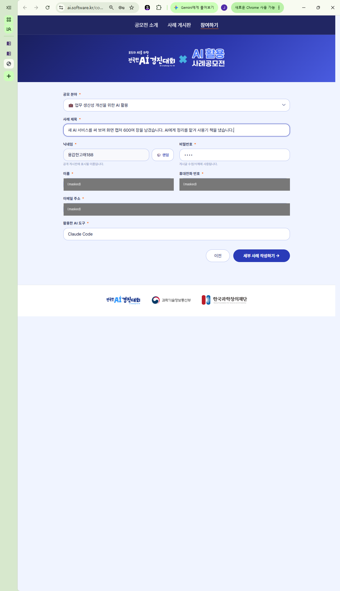
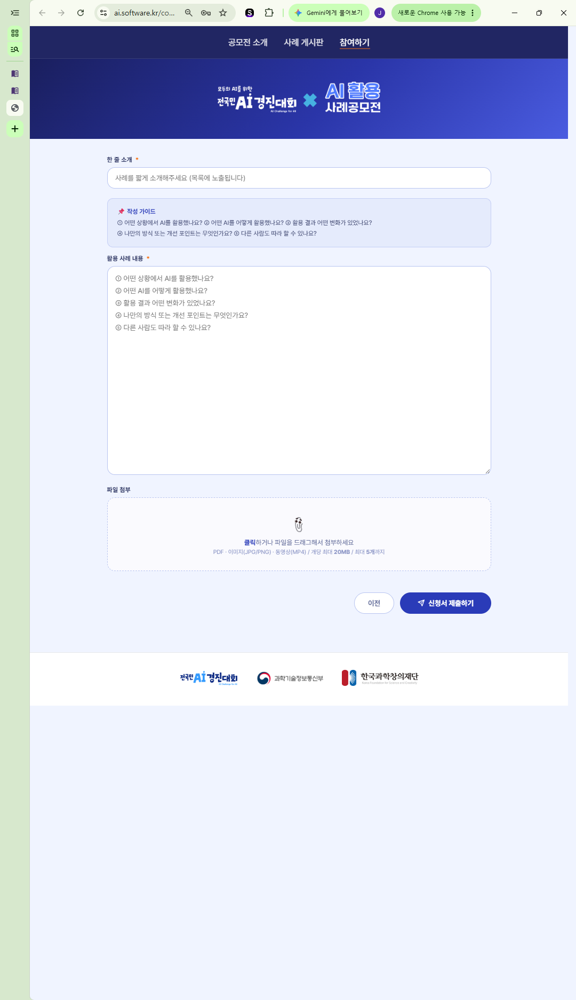

# 2026 전국민 AI 활용 사례 공모전 시즌3 — 공모 정보 전체

> 다른 PC에서 작업하기 위해 공모 관련 정보를 한곳에 모은 문서. 2026-10-25 기준.
> 평가 기준은 [평가기준.md](평가기준.md)에 따로 있다. 작업 진행 상황은 [../이어하기.md](../이어하기.md).

## 폴더 구성

| 파일 | 내용 |
|---|---|
| `공모정보_전체.md` | 이 문서 (일정·접수 방법·칸별 안내·링크·지난 시즌 수상작) |
| `평가기준.md` | 평가 기준 100점, 인정 범위, 유의사항 |
| `images/` | 접수 화면 캡처 4장 (3번은 이름·전화·이메일 가림) |
| `원본/대회안내_v2.pdf` | 사례 공모전 공식 안내 PDF (평가 기준·유의사항·확인 서약) |
| `원본/전국민_AI_경진대회_통합_공고문.pdf` | 과기정통부 공고 제2026-0376호 (대회 전체 통합 공고) |
| `수상작_원문/` | 시즌1·2 수상작 24편의 제목·한 줄 소개·AI 도구·본문·첨부 링크 (게시판 원문, 2026-10-25 수집) |

---

## 1. 개요

| 항목 | 내용 |
|---|---|
| 대회 | 2026 전국민 AI 경진대회 — AI 활용 사례 공모전 |
| 주최·주관 | 과학기술정보통신부, 한국과학창의재단(KOSAC) |
| 참가 대상 | 일반 국민 누구나, **개인 참가만** (팀 불가) |
| 공모 분야 | ① 생활 속 AI 활용 ② 지역사회 문제해결을 위한 AI 활용 ③ 교육·학습을 위한 AI 활용 ④ **업무 생산성 개선을 위한 AI 활용** |
| 참가 방법 | 블로그형(이미지·텍스트), 숏폼(1분 이내 영상) 등 결과물을 공모전 웹사이트에 올림 |
| 중복 응모 | 여러 분야·시즌 중복 가능. 최종 수상은 1인 1건 |

공모 분야 상세 (시즌3 OPEN 공지 원문):
- ① 생활 속 AI 활용: 가사·육아 보조(일정 관리, 번역, 요약), 건강·운동 관리, 금융·소비, 취미·여가(여행 계획, 글쓰기, 그림, 음악)
- ② 지역사회 문제해결: 동네 가게 홍보 포스터, AI 다국어 행정 안내 도우미
- ③ 교육·학습: 자기주도 학습, 교사 수업 준비
- ④ 업무 생산성: 공문·보고서 초안 작성, 회의 요약 등 업무 프로세스 개선

## 2. 일정

| 시기 | 내용 |
|---|---|
| 04-01 ~ 06-30 | 시즌1 접수 → 07-23 결과 발표 |
| 07-01 ~ 08-31 | 시즌2 접수 → 09-22 결과 발표 |
| **09-01(화) ~ 10-31(토)** | **시즌3 접수** ← 지금 |
| **11-20(금) 예정** | 시즌3 수상 발표 (주최 측 사정으로 바뀔 수 있음) |
| 11월 | 결선 (시즌 수상작 자동 출전) |
| 12월 | 본선 심사·시상식 |

- 목표 제출일: **10-29** (제출 뒤에도 비밀번호로 수정 가능)

## 3. 시상

**시즌별 (시즌3 OPEN 공지)**
- 최우수 1점: 태블릿 PC
- 우수 12점 (분야별 3점): 10만 원 상품권
- 발표 이미지를 세어 보면 시즌마다 12점이고 최우수는 그 안에 포함 (분야별 3점 × 4)
- 시즌 수상작은 **결선에 자동 출전**. 결선 진출자에게 심사위원 의견을 주고, 원하면 고친 작품을 다시 낼 수 있음 (시즌1 Q&A)

**본선 (12월, 통합 공고)** — 총 3,400만 원, 36점 내외
- 최우수 2명: 각 500만 원 (과학기술정보통신부 장관상)
- 우수 12명: 각 200만 원 (한국과학창의재단 이사장상)
- 장려 22명: 10만 원 상당 경품

## 4. 접수 방법

흐름: 통합 홈페이지 → 메뉴 **참가 트랙** → **AI 활용 사례 공모전** → **참가신청** → 접수 페이지

| 단계 | 내용 |
|---|---|
| 1. 약관 동의 | 개인정보 수집·이용(필수), 개인정보 제3자 제공(필수, 마이스 플랜즈·심사 목적), 공모전 참여 유의사항(필수), 확인 서약(필수), 홍보물 활용(선택), 뉴스레터(선택) |
| 2. 신청서 1쪽 | 공모 분야 → 사례 제목 → 닉네임(공개 게시판 표시, 랜덤 가능) → 비밀번호(4자 이상) → 이름 → 휴대전화 → 이메일 → 활용한 AI 도구 → "세부 사례 작성하기" |
| 3. 신청서 2쪽 | 한 줄 소개 → (작성 가이드) → 활용 사례 내용 → 파일 첨부 → "신청서 제출하기" |
| 4. 제출 후 | 사례 게시판에 공개됨. 회원가입 없음, 글마다 비밀번호로 수정 (삭제 단추는 숨겨져 있음) |

**칸별 안내 문구와 제한**

| 칸 | 화면 안내 문구 | 제한 |
|---|---|---|
| 공모 분야 | 업무 생산성 개선을 위한 AI 활용 (선택 목록) | — |
| 사례 제목 | "AI를 활용한 사례를 한 문장으로 표현해주세요" | 200자 |
| 활용한 AI 도구 | 한 줄 입력, "예: ChatGPT, Upstage Solar, 뤼튼, 코파일럿 등" | 500자 |
| 한 줄 소개 | "사례를 짧게 소개해주세요 (목록에 노출됩니다)" | 200자 |
| 활용 사례 내용 | 큰 입력칸, 다섯 질문이 회색 안내 글로 들어 있음 | 표시 없음 |
| 파일 첨부 | PDF · 이미지(JPG/PNG) · 동영상(MP4) | 개당 20MB, 최대 5개 |

- 활용 사례 내용은 **일반 텍스트 상자**: 줄바꿈만 유지되고 표·굵은 글씨·마크다운은 안 됨. 그림은 본문에 못 넣으므로 그림이 든 본문은 PDF 첨부로 내는 사례가 많음
- **작성 가이드 (접수 화면 원문)**
  1. 어떤 상황에서 AI를 활용했나요?
  2. 어떤 AI를 어떻게 활용했나요?
  3. 활용 결과 어떤 변화가 있었나요?
  4. 나만의 방식 또는 개선 포인트는 무엇인가요?
  5. 다른 사람도 따라 할 수 있나요?

## 5. 접수 화면 캡처 (2026-10-23)

### ① 약관 동의

### ② 신청서 1쪽 (빈칸, 안내 문구)

### ③ 신청서 1쪽 (입력 예, 개인정보 가림)
제목 칸은 v7 시점의 임시 제목. 이름·휴대전화·이메일은 회색으로 가렸다.

### ④ 신청서 2쪽 (한 줄 소개, 작성 가이드, 사례 내용, 첨부)

> 원본 캡처(가리지 않은 것)는 `02_제출물/captured_images/`에 있고, 개인정보가 있어 커밋하지 않는다.

## 6. 링크

**공식 사이트**
- 전국민 AI 경진대회 홈페이지: https://aichallenge4all.or.kr
- 사례 공모전 소개 (안내 PDF, 참가신청 버튼): https://aichallenge4all.or.kr/competitions/case-contest
- 접수 페이지: https://ai.software.kr/contest/apply
- 사례 게시판 (전체): https://ai.software.kr/board?brdTp=CONTEST
- 사례 게시판 (업무 생산성): https://ai.software.kr/board/work
- 공지사항: https://aichallenge4all.or.kr/notice
- Q&A 게시판: https://aichallenge4all.or.kr/qna
- 카카오톡 채널: https://pf.kakao.com/_sMxcEX

**공지**
- 통합 공고 (03-30, 과기정통부 공고 제2026-0376호): https://aichallenge4all.or.kr/notice/cmnctgb2f001evklgnmg0u3gh
  - 공고문 PDF: https://file.aichallenge4all.or.kr/notices/1777340176288_전국민_AI_경진대회_통합_공고문.pdf
- 시즌1 우수작품 선정 결과 발표 (07-23): https://aichallenge4all.or.kr/notice/cmrwtvha10001aqans4zjr16w
- 시즌1 Q&A (07-23): https://aichallenge4all.or.kr/notice/cmrwtvh9m0000aqani12hmsps
- 시즌2 우수작품 발표 (09-22): https://aichallenge4all.or.kr/notice/cmucdygya0019fzyl9v8u4dzb
- **시즌3 OPEN (09-02)**: https://aichallenge4all.or.kr/notice/cmtjpa73f000m149hjskkpv4x
- 참고: 시즌3 기간 이벤트 "우리 AI와의 세 번째 만남" (10-19~10-31, 공모전과 별개의 경품 이벤트): https://aichallenge4all.or.kr/notice/cmvf1mapz000ocdstpallzalk

**외부 공고 (참고)**
- 시즌1 공고 (씽유): https://thinkyou.co.kr/contest/63710/
- 시즌2 공고 (링커리어): https://linkareer.com/activity/332400

## 7. 시즌1·2 수상작 링크

본문 전체는 `수상작_원문/` 폴더에 파일로 저장해 두었다 (파일 이름 `S시즌_분야_글번호_제목.md`). 글자 수는 공백 포함 본문 길이.

### 시즌1 (07-23 발표, 12점)

| 분야 | 제목 | 본문 |
|---|---|---|
| 교육 | [다양한 AI를 활용한 문화유산 창의융합 교육 콘텐츠 개발 및 실제 수업 적용 사례](https://ai.software.kr/board/education/464) | 2,716자 |
| 교육 | [출퇴근 40분, Gemini로 말하고 Claude로 다듬고 NotebookLM으로 쌓는다](https://ai.software.kr/board/education/72) | 2,126자 |
| 교육 | [나만의 AI 파이썬 배움터: 대화형 제어 기반 자기주도 학습 시스템 구축 사례](https://ai.software.kr/board/education/68) | 1,678자 |
| 생활 | [강의도 코딩도 없이: 평범한 직장인이 무료 AI만으로 콘텐츠를 만들게 된 9개월](https://ai.software.kr/board/daily/358) | 1,688자 |
| 생활 | [AI를 활용한 운동기록 분석 및 훈련계획 업데이트 자동화](https://ai.software.kr/board/daily/374) | 3,187자 |
| 생활 | [국가CCTV를 활용한 나만의 맞춤형 관제센터, 네비게이션(NAVIYA)](https://ai.software.kr/board/daily/109) | 607자 |
| **업무** | [통제된 AI 비서: 직장인 1명이 만든 디지털 직원 시스템](https://ai.software.kr/board/work/130) | 4,336자 |
| **업무** | [퇴근 후에도 놓지 못한 업무노트, 학교폭력책임교사 아내를 위해 남편이 만든 AI 업무 비서](https://ai.software.kr/board/work/18) | 4,776자 |
| **업무** | [결정은 사람이, 나머지는 AI가](https://ai.software.kr/board/work/372) (국제회의 번역·회의록) | 2,832자 |
| 지역 ★최우수 | [전남 22개 시군 관광 활성화를 위한 AI 추천 플랫폼: TourAPI + RAG](https://ai.software.kr/board/community/219) | 2,276자 |
| 지역 | [AI 다국어 전통시장 활성화 플랫폼](https://ai.software.kr/board/community/77) | 1,665자 |
| 지역 | [(실제 사례) AI x QR코드로 30초 문제해결](https://ai.software.kr/board/community/412) | 1,649자 |

### 시즌2 (09-22 발표, 12점)

| 분야 | 제목 | 본문 |
|---|---|---|
| 교육 | [강의안 100여 장과 실습 파일 수십 개: 수업 준비를 AI와 반나절에 끝내는 강사의 방법](https://ai.software.kr/board/education/491) | 2,319자 |
| 교육 ★최우수 | [생성형 AI로 개발한 '전지적 지구 시점'을 활용한 초등 과학 수업](https://ai.software.kr/board/education/554) | 4,338자 |
| 교육 | [나는 왜 수학 문제를 느리게 풀까?: AI에게 내 풀이 기록을 통째로 맡겨봤다](https://ai.software.kr/board/education/830) | 1,259자 |
| 생활 | [새 앱 없이, 어머니의 라인 안으로 들어간 AI 말동무 '온담이'](https://ai.software.kr/board/daily/536) | 2,227자 |
| 생활 | [새벽 3시, 아기 울음을 통역하는 AI 육아 비서](https://ai.software.kr/board/daily/562) | 3,872자 |
| 생활 | [카카오톡 링크·파일 정리 앱 LinkScape를 직접 개발한 사례](https://ai.software.kr/board/daily/635) | 9,380자 |
| **업무** | [AI로 병원 회진 음성·스캔 진료기록·차트 정보를 통합 요약한 사례](https://ai.software.kr/board/work/493) | 3,293자 |
| **업무** | [트럭은 못 몰아서, AI를 몰았습니다](https://ai.software.kr/board/work/501) (중소기업 배차) | 1,802자 |
| **업무** | [우리 회사 환경에 꼭 맞게 AI와 직접 만든 사내 관리툴, 전 직원이 매일 쓰고 있습니다](https://ai.software.kr/board/work/899) | 6,205자 |
| 지역 | [소상공인 AI 기반 능동형 자율 마케팅 시스템 AM](https://ai.software.kr/board/community/557) | 4,553자 |
| 지역 | [지역 안전 도우미 'OLA'](https://ai.software.kr/board/community/749) | 1,696자 |
| 지역 | [AI가 담당 부서까지 데려다주는 '고양이 민원네비게이션'](https://ai.software.kr/board/community/802) | 2,284자 |

- 비교 참고 (수상작 아님, 시즌3 접수작): [AI 코딩 에이전트와 나흘 동안 공모전 12건](https://ai.software.kr/board/work/1569)
- 수상작 분석과 시사점: [../참고_지난시즌분석.md](../참고_지난시즌분석.md)

## 8. 문의처

| 구분 | 연락처 | 출처 |
|---|---|---|
| **사례 공모전 문의 (공식)** | **kosacai@kosac.re.kr** | 공식 안내 PDF v2 |
| 사례 공모전 담당 | 02-559-3917 / jhssong@kosac.re.kr | 통합 공고문 |
| 전국민 AI 경진대회 사무국 | aichallenge4all@gmail.com | 통합 공고문 |
| 공지 표기 메일 | aichallengeall@gmail.com (위와 철자 다름) | 시즌3 OPEN 공지 |
| 카카오톡 채널 | https://pf.kakao.com/_sMxcEX | 소개 페이지 |
| Q&A 게시판 | https://aichallenge4all.or.kr/qna | 소개 페이지 |
